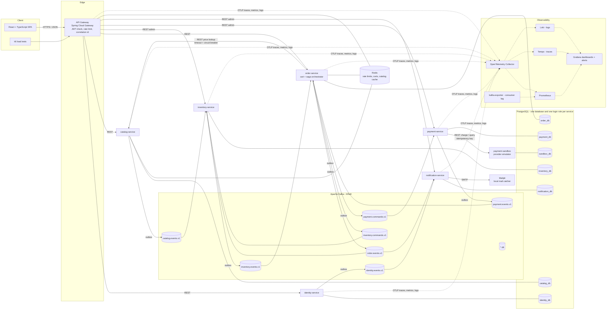
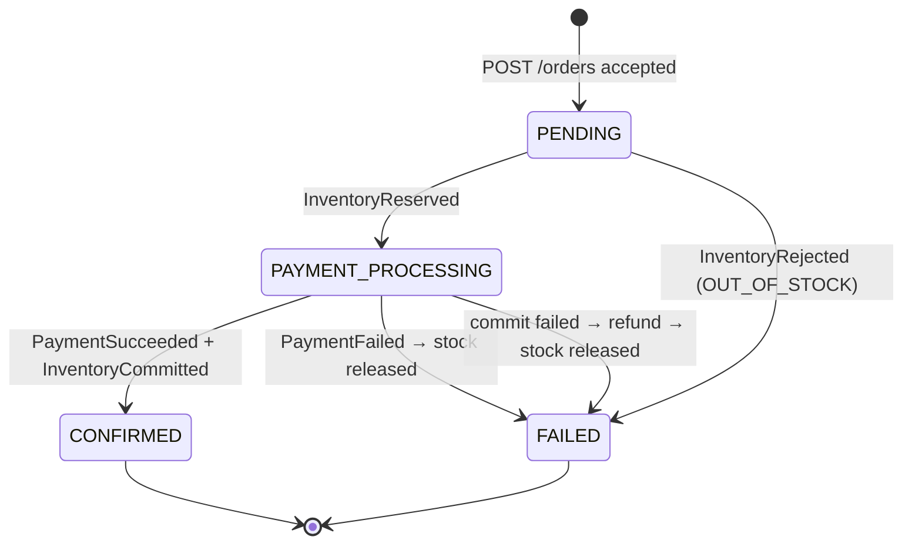
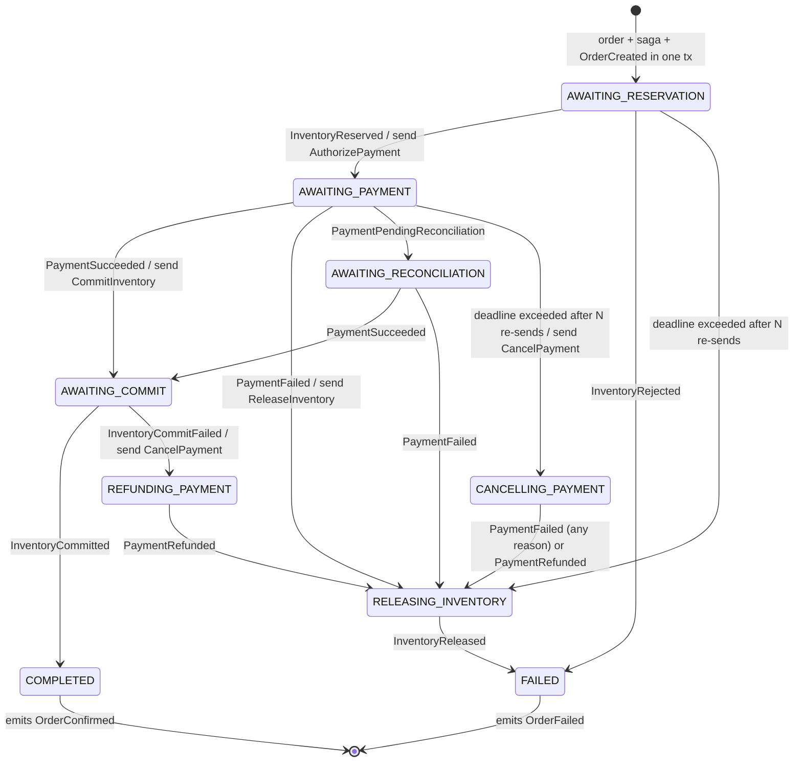
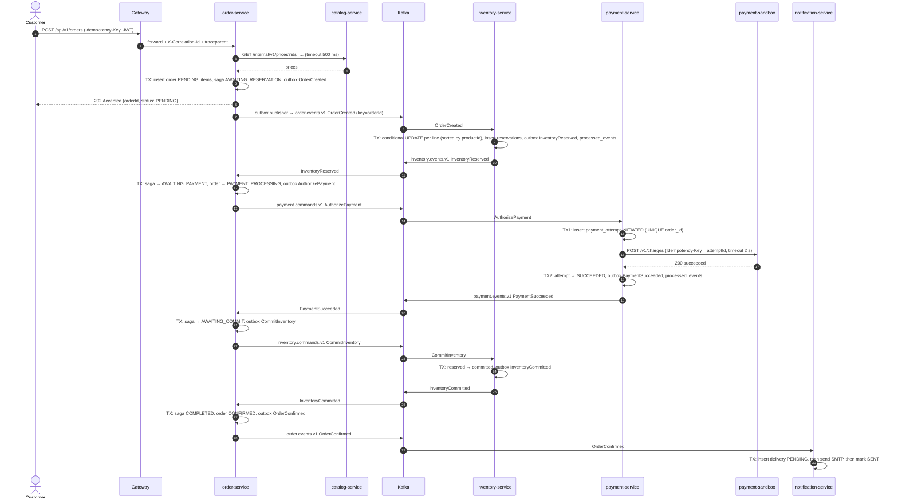
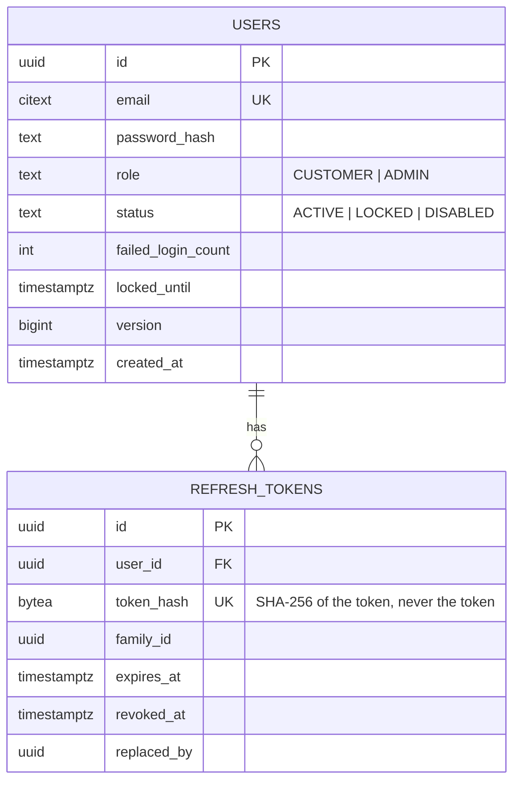
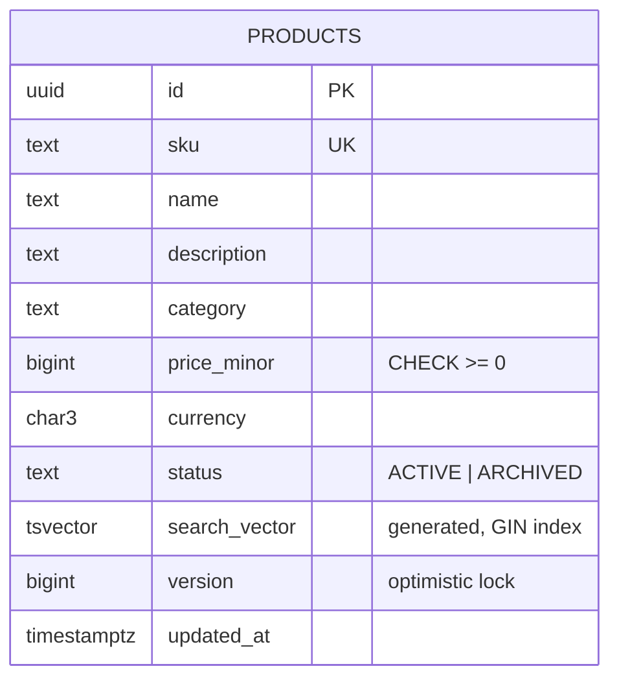
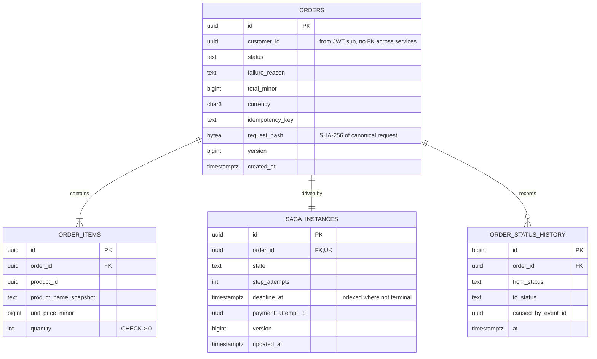
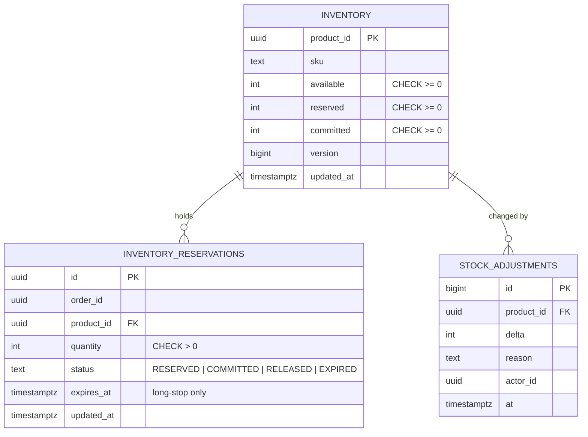
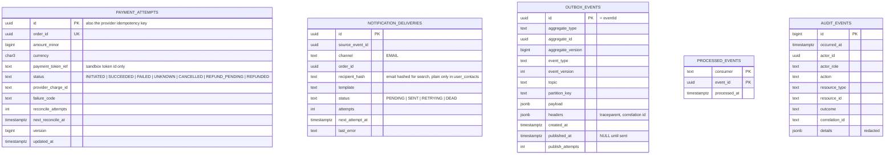
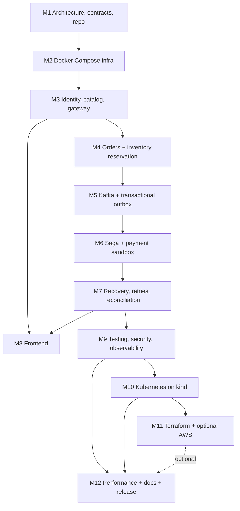

# CommerceFlow — System Architecture

| | |
|---|---|
| Document status | Draft v0.1 — produced in Milestone 1 |
| Last updated | 2026-11-01 |
| Scope | Sections A–L of the project brief. Implementation detail lives in [ROADMAP.md](../ROADMAP.md); decisions in [docs/adr](../adr). |

Nothing in this document is a measured result. Every number in sections B and J is a **target** until a test report in `docs/reports/` proves it.

---

## A. Business problem statement

A retailer sells products whose stock is limited and sometimes a single unit. Checkout spans five independently deployed services (order, inventory, payment, notification, identity) that each own their data, so no single database transaction can cover a purchase. Under concurrent demand, partial outages, and an unreliable network, the platform must still guarantee that it:

1. **never sells stock it does not have**, even when many customers race for the last unit;
2. **never charges a customer more than once** for one logical purchase, even when requests, commands, or provider responses are duplicated or lost;
3. **never loses an accepted order**: once the API returns `202 Accepted`, the order is durable and will reach a terminal state (`CONFIRMED` or `FAILED`) after any recoverable failure;
4. **never confirms an order** without both a successful payment and committed stock;
5. keeps read APIs fast under load and keeps every money- and stock-affecting action authenticated, authorised, and auditable.

Each problem from the brief maps to a concrete mechanism:

| # | Problem | Mechanism (where it is implemented) |
|---|---|---|
| 1 | Many buyers, last unit | Single conditional `UPDATE … WHERE available >= qty` plus a `CHECK (available >= 0)` constraint in inventory-service |
| 2 | Duplicate order requests and payment events | `Idempotency-Key` on `POST /orders` (unique `(user_id, idempotency_key)`), consumer dedupe table, unique `payment_attempts.order_id`, provider idempotency key |
| 3 | Service crash mid-checkout | Persisted saga state, transactional outbox, offsets committed only after the DB transaction commits, saga deadline sweeper |
| 4 | Payment succeeded, acknowledgement lost | Write-ahead `payment_attempts` row, `UNKNOWN` status, reconciliation job that queries the provider by idempotency key |
| 5 | Kafka or DB unavailable | Outbox buffers events while Kafka is down; bounded retries with jitter; health probes fail fast so traffic drains |
| 6 | Orders stuck `PENDING` | Saga deadlines with bounded re-sends, then fail-safe compensation |
| 7 | Delayed / out-of-order messages | Saga state machine rejects transitions invalid for the current state; `aggregateVersion` monotonic check |
| 8 | Recovery and replay | Idempotent consumers at two layers (event id + business key), DLT replay tool, offset-reset runbook |
| 9 | Latency under load | Redis cache-aside for catalog reads, Postgres indexes and full-text search, connection-pool sizing, k6 evidence |
| 10 | AuthN/AuthZ and auditing | RS256 JWT, role checks at gateway *and* service, owner-scoped queries, per-service `audit_events` written in the business transaction |

---

## B. Requirements

### B.1 Functional requirements

| ID | Requirement | Owner |
|---|---|---|
| FR-01 | A visitor can register with email and password. A duplicate email returns `409`, which does reveal that the account exists; this is accepted (most sites do the same) and mitigated by per-IP rate limits on registration. Login, by contrast, never reveals whether an email exists | identity |
| FR-02 | A user can log in, refresh a session (rotating refresh token), and log out | identity |
| FR-03 | Roles `CUSTOMER` and `ADMIN`; the first admin is bootstrapped from environment configuration, never from a hardcoded credential | identity |
| FR-04 | Anyone can list, page, filter by category, and full-text search active products | catalog |
| FR-05 | An admin can create, update, archive products and change prices | catalog |
| FR-06 | An admin can set and adjust stock levels; every adjustment is audited | inventory |
| FR-07 | A customer can add, change, and remove cart items | order (cart in Redis) |
| FR-08 | A customer can submit an order with an `Idempotency-Key`; resubmitting the same key returns the original order | order |
| FR-09 | A customer can view their own order history and the status of each order, and nobody else's | order |
| FR-10 | Stock is reserved per order, committed on payment success, and released on failure | inventory |
| FR-11 | Payment uses a self-hosted sandbox provider that supports success, decline, timeout, and unknown outcomes; no card data is ever stored | payment, payment-sandbox |
| FR-12 | Payment uncertainty is resolved by a reconciliation job | payment |
| FR-13 | A failed payment releases stock automatically; a payment that succeeded but cannot be honoured is refunded automatically | order (saga) |
| FR-14 | Customers receive confirmation or failure emails (captured locally by Mailpit); delivery is retried and its status recorded | notification |
| FR-15 | An admin dashboard shows orders by status, stuck sagas, DLT counts, and stock levels | frontend + services |
| FR-16 | Each service exposes liveness, readiness, and Prometheus metrics endpoints | all |
| FR-17 | An admin can list and replay dead-lettered events | all consumers |

### B.2 Non-functional requirements

| ID | Category | Requirement (target, to be measured) |
|---|---|---|
| NFR-01 | Correctness | Zero oversells in a 100-concurrent-orders-for-1-unit test, repeated 20 times |
| NFR-02 | Correctness | Zero duplicate successful charges when every command and event is delivered 3× |
| NFR-03 | Durability | Zero lost accepted orders across the failure scenarios in section J |
| NFR-04 | Liveness | Every order reaches a terminal state within 2 minutes of the last dependency recovering (payment reconciliation excepted: bounded by its own window, default 15 min) |
| NFR-05 | Performance | p95 < 300 ms for `GET /products`, `GET /products/{id}`, `GET /orders/{id}` at 500 virtual users on the documented workload and hardware |
| NFR-06 | Availability | Each service restarts cleanly; graceful shutdown finishes in-flight requests and Kafka records within 30 s |
| NFR-07 | Security | OWASP ASVS L1-aligned controls listed in section D.4; no high/critical findings from Trivy left untriaged |
| NFR-08 | Observability | One trace shows a checkout across gateway → order → Kafka → inventory → payment; every log line carries `traceId` and `correlationId` |
| NFR-09 | Operability | `./scripts/dev-up` brings up the whole stack from a clean clone with at most one manual step (copying `.env.example` to `.env`) |
| NFR-10 | Cost | Every required step runs on free, self-hosted tooling. Cloud deployment is optional and gated on explicit approval |
| NFR-11 | Maintainability | ≥ 80 % line coverage on domain and saga packages (JaCoCo); all services build with one Maven command |
| NFR-12 | Evolvability | Event schemas are versioned; CI rejects a schema change that breaks a stored example of the previous version |

### B.3 Business invariants

These are the properties the tests in section J assert. They are written as checkable predicates.

| ID | Invariant | Enforced by |
|---|---|---|
| INV-1 | For every product, `available >= 0`, `reserved >= 0`, `committed >= 0` | DB `CHECK` constraints and the conditional `UPDATE` |
| INV-2 | For every product, `available + reserved + committed = total_received - total_written_off` (stock is conserved) | Single-transaction updates in inventory; property test after every scenario |
| INV-3 | At most one `SUCCEEDED` charge exists per order, at the provider and in `payment_attempts` | `UNIQUE(order_id)` on `payment_attempts`; provider idempotency key = attempt id |
| INV-4 | An order is `CONFIRMED` ⇒ a `SUCCEEDED` payment attempt and `COMMITTED` reservations exist for every line | Saga only enters `COMPLETED` after receiving both `PaymentSucceeded` and `InventoryCommitted` |
| INV-5 | An order is `FAILED` ⇒ its reservations are `RELEASED` (or never existed) **and** no un-refunded successful charge exists | Compensation steps run before the saga enters `FAILED` |
| INV-6 | Every accepted order eventually reaches `CONFIRMED` or `FAILED` once dependencies recover | Saga deadline sweeper with bounded attempts and fail-safe compensation |
| INV-7 | A customer can read and act only on resources they own; cross-account reads return `404` | Owner predicate inside every repository query, not just a controller check |
| INV-8 | No card number, CVV, password, or token value ever appears in a DB row, event, or log line | Sandbox tokens only; schemas with `additionalProperties: false`; log redaction; a test that greps captured logs |

### B.4 Delivery guarantee — stated precisely

Kafka delivery in this system is **at-least-once**. Producers are idempotent (`enable.idempotence=true`, `acks=all`), which removes broker-level duplicates from producer retries, but the outbox publisher can still publish an event twice if it crashes between the broker ack and marking the row published. Consumers make their *side effects* idempotent by recording `(consumer, event_id)` in the same database transaction as the effect, and business keys (`order_id` on reservations and payment attempts) make re-sent commands harmless even after the dedupe window expires.

The claim is therefore **"effectively-once side effects per consumer for the tested failure scenarios"**. We do not claim end-to-end exactly-once: Kafka transactions only cover Kafka-to-Kafka, and the payment provider and SMTP server are outside any transaction we control. An email may be sent twice if the SMTP send succeeds and the process dies before recording it; this is documented and accepted.

---

## C. High-level system architecture



---

## D. Microservice responsibilities and communication

### D.1 Services

| Service | Owns (data) | Responsibilities | Exposes | Consumes | Produces |
|---|---|---|---|---|---|
| **api-gateway** | none (Redis keys for rate limits) | Routing, JWT signature/expiry check, coarse role check on `/admin/**`, token-bucket rate limits, `X-Correlation-Id` generation, W3C `traceparent` propagation, security headers, request size limits, CORS | `:8080` public | — | — |
| **identity-service** | `users`, `refresh_tokens`, `audit_events` | Registration, Argon2id hashing, login with lockout, RS256 access tokens (15 min), rotating refresh tokens (7 days) with reuse detection, JWKS endpoint, admin bootstrap | `/api/v1/auth/**`, `/.well-known/jwks.json` | — | `identity.events.v1` |
| **catalog-service** | `products`, `audit_events` | Product CRUD, pricing in minor units, Postgres full-text search, Redis cache-aside, optimistic locking for admin edits | `/api/v1/products/**`, `/api/v1/admin/products/**`, internal `/internal/v1/prices` | — | `catalog.events.v1` |
| **order-service** | `orders`, `order_items`, `saga_instances`, `order_status_history`, `outbox_events`, `processed_events`, `audit_events`; Redis `cart:*` | Cart, idempotent order submission, price snapshot, **saga orchestrator**, saga deadline sweeper, order history | `/api/v1/cart/**`, `/api/v1/orders/**`, `/api/v1/admin/orders/**` | `inventory.events.v1`, `payment.events.v1` | `order.events.v1`, `inventory.commands.v1`, `payment.commands.v1` |
| **inventory-service** | `inventory`, `inventory_reservations`, `stock_adjustments`, `outbox_events`, `processed_events`, `audit_events` | Atomic all-or-nothing reservation, commit, release, admin stock adjustments, long-stop reservation expiry with alert | `/api/v1/admin/inventory/**`, `/api/v1/inventory/{productId}` (public availability) | `order.events.v1` (`OrderCreated`), `inventory.commands.v1`, `catalog.events.v1` | `inventory.events.v1` |
| **payment-service** | `payment_attempts`, `outbox_events`, `processed_events`, `audit_events` | Write-ahead payment attempts, idempotent charge via sandbox, timeout and unknown handling, reconciliation, cancel-or-refund, circuit breaker on provider | `/api/v1/admin/payments/**` | `payment.commands.v1` | `payment.events.v1` |
| **payment-sandbox** | `charges` (own DB, so it survives restarts) | Stripe-like provider simulator: idempotency keys, magic tokens for outcomes, injectable latency and faults, charge lookup by idempotency key, refunds | `:8099` internal only | — | — |
| **notification-service** | `notification_deliveries`, `user_contacts`, `processed_events` | Consumes final order events, renders templates, sends SMTP to Mailpit, retries with backoff, records status, keeps a contact projection from `UserRegistered` | `/api/v1/admin/notifications/**` | `order.events.v1`, `identity.events.v1` | — |

The payment-sandbox is a separate deployable on purpose: the "payment succeeded, acknowledgement lost" scenario is only meaningful if the provider keeps its own state when payment-service crashes.

### D.2 Communication rules

| Rule | Why |
|---|---|
| Synchronous REST only on the user request path (gateway → service), for the price lookup (order → catalog), and to the external provider (payment → sandbox) | Each synchronous edge is a coupling point; keeping three keeps the availability math easy to reason about |
| Every synchronous call has a connect timeout, a response timeout, and a Resilience4j circuit breaker | A slow dependency must not exhaust the caller's thread or connection pools |
| Everything that changes another service's state goes through Kafka via the sender's outbox | A DB commit and a Kafka send cannot be made atomic; the outbox makes the event part of the DB commit |
| Kafka message key = `orderId` for all checkout topics, `productId` for catalog, `userId` for identity | All messages about one order land on one partition of a given topic, so they are ordered relative to each other on that topic |
| Services never connect to another service's database; each login role can only `CONNECT` to its own database | Data ownership enforced by Postgres permissions, verified by a test in Milestone 2 |
| The gateway checks tokens, **and** each service re-validates the JWT and enforces its own authorisation | Defence in depth: a misrouted or internal call still cannot bypass authorisation |

### D.3 Ports (local)

| Component | Port |
|---|---|
| api-gateway | 8080 (management 8090, internal only) |
| identity / catalog / order / inventory / payment / notification | 8081 / 8082 / 8083 / 8084 / 8085 / 8086 |
| payment-sandbox | 8099 |
| frontend (Vite dev) | 5173 |
| PostgreSQL / Redis / Kafka | 5432 / 6379 / 9092 |
| Grafana / Prometheus / Mailpit UI | 3000 / 9090 / 8025 |

### D.4 Security controls (summary)

Argon2id password hashing (outside any database transaction); account lockout for 15 minutes after 5 consecutive failures, plus per-IP rate limits on login at the gateway; RS256 JWT with `kid` rotation via JWKS; refresh-token rotation with family revocation on reuse; Bean Validation on every request DTO with size limits; RFC 9457 `application/problem+json` error bodies that never include stack traces or SQL; JPA parameter binding only (no string-built SQL); owner-scoped repository queries; per-service least-privilege DB roles; secrets only from environment or Kubernetes Secrets, with `.env` git-ignored and gitleaks in CI; Trivy for dependency and image scanning; CodeQL on the public repo; non-root distroless-style container images; audit rows that store actor, action, resource, outcome, and correlation id but never secrets. Details go in `docs/security/SECURITY.md` in Milestone 9.

---

## E. End-to-end order lifecycle

### E.1 Customer-visible order status



`FAILED` always carries a `failureReason`: `OUT_OF_STOCK`, `PAYMENT_DECLINED`, `PAYMENT_TIMEOUT`, `PRICE_UNAVAILABLE`, or `INTERNAL_ERROR`.

### E.2 Saga state machine (internal, persisted in `saga_instances`)



Rules the implementation must follow:

1. **One transaction per transition.** Load the saga row `FOR UPDATE`, check the event is valid for the current state, apply the transition, update the order, write the next command or event to the outbox, insert into `processed_events`, commit. Kafka offset is committed only after that.
2. **Invalid-for-state events are acknowledged and ignored**, with a counter metric `saga_event_ignored_total{reason}`. A duplicate `InventoryReserved` arriving in `AWAITING_COMMIT` is ignored, never re-applied.
3. **Deadlines.** Each waiting state sets `deadline_at`. A sweeper (`SELECT … FOR UPDATE SKIP LOCKED`) re-sends the current step's command with exponential backoff and jitter, up to `max_attempts` (default 5). Re-sends are safe because receivers are idempotent by `orderId`.
4. **Fail-safe compensation.** When the outcome of a step is unknown after the last attempt, the saga issues the compensating command anyway (`ReleaseInventory`, `CancelPayment`); both are no-ops if nothing happened.
5. **`CancelPayment` leaves a tombstone.** If payment-service has no attempt for the order, it inserts one with status `CANCELLED`. A late `AuthorizePayment` then hits `UNIQUE(order_id)` and is answered with `PaymentFailed(CANCELLED)` instead of charging. This closes the race between "saga gave up" and "command finally arrived".
6. **Reservations are not expired by inventory while a saga can still use them.** Inventory has only a long-stop expiry (default 24 h) that raises an alert; normal release is always driven by the saga. This avoids "payment succeeded but the stock was already released".
7. **The customer sees `FAILED` only once compensation has finished.** While stock is being released or a charge refunded, the order stays `PAYMENT_PROCESSING`. The table itself is `SagaTransitions` in order-service; ADR-0011 records how it and payment-service are built.

### E.3 Happy path



### E.4 Failure paths

| Scenario | What happens | Terminal state | Invariants checked |
|---|---|---|---|
| Out of stock (any line) | Inventory transaction rolls back every line it touched, publishes `InventoryRejected` | `FAILED / OUT_OF_STOCK` | INV-1, INV-2 |
| Card declined | Sandbox returns `402`; payment publishes `PaymentFailed(DECLINED)`; saga sends `ReleaseInventory` | `FAILED / PAYMENT_DECLINED` | INV-2, INV-5 |
| Provider timeout | Attempt marked `UNKNOWN`; `PaymentPendingReconciliation` published; reconciler queries sandbox by idempotency key with backoff; resolves to succeeded or failed | `CONFIRMED` or `FAILED` | INV-3, INV-4/5 |
| Payment-service dies after the sandbox charged but before it recorded the result | On restart, the `INITIATED` attempt older than the provider timeout is picked up by the reconciler, which finds the charge and publishes `PaymentSucceeded` | `CONFIRMED`, exactly one charge | INV-3 |
| Inventory-service killed during checkout | `OrderCreated` stays in Kafka uncommitted; on restart the consumer re-reads it; dedupe or the unique `(order_id, product_id)` makes the second attempt a no-op | `CONFIRMED` | INV-1, INV-2 |
| Kafka down | Business transactions keep committing; outbox rows accumulate; `outbox_oldest_unpublished_age_seconds` alert fires; publisher drains on recovery | Unchanged, only delayed | INV-6 |
| Postgres down | Requests fail fast with `503`; readiness probe goes `DOWN`; consumers pause on repeated errors; nothing is acknowledged that was not committed | Unchanged, only delayed | INV-6 |
| Inventory commit fails (reservation hit long-stop expiry) | Saga sends `CancelPayment`, payment refunds, saga releases | `FAILED / INTERNAL_ERROR`, refund recorded | INV-5 |
| Same event delivered 3× | First delivery applies; others hit `processed_events` primary key and are skipped | Same as single delivery | INV-2, INV-3 |
| Old events replayed (offset reset) | Event-id dedupe catches anything inside the retention window; business-key uniqueness and state checks catch anything older | No state change | All |

---

## F. Kafka event definitions and message flow

### F.1 Envelope (every message)

```json
{
  "eventId": "0192f3c4-7a1e-7b2c-9d4e-5f6a7b8c9d0e",
  "eventType": "OrderCreated",
  "eventVersion": 1,
  "occurredAt": "2026-11-01T10:15:30.123Z",
  "producer": "order-service",
  "aggregateType": "Order",
  "aggregateId": "4b8c…",
  "aggregateVersion": 1,
  "correlationId": "c0ffee…",
  "causationId": null,
  "payload": { }
}
```

- `eventId` is a UUID (v7 preferred so primary-key inserts stay index-friendly). It is the dedupe key.
- `aggregateVersion` increases by one for every event an aggregate emits; consumers that care about order can ignore an event whose version is not greater than the last one they applied.
- `traceparent` and `X-Correlation-Id` also travel as Kafka **headers** so tracing works without parsing the payload. The outbox stores them in a `headers` column, because the original request's trace context is gone by the time the publisher thread runs.
- Money is always `amountMinor` (integer, e.g. cents) plus `currency` (ISO 4217). Never floating point.

Schemas live in `contracts/src/main/resources/events/v1/` (JSON Schema draft 2020-12) with valid and invalid examples that CI checks.

### F.2 Topic catalogue

| Topic | Key | Partitions (local) | Producer | Consumers | Message types |
|---|---|---|---|---|---|
| `order.events.v1` | orderId | 6 | order | inventory, notification | `OrderCreated`, `OrderConfirmed`, `OrderFailed` |
| `inventory.commands.v1` | orderId | 6 | order | inventory | `CommitInventory`, `ReleaseInventory` |
| `inventory.events.v1` | orderId | 6 | inventory | order | `InventoryReserved`, `InventoryRejected`, `InventoryCommitted`, `InventoryCommitFailed`, `InventoryReleased` |
| `payment.commands.v1` | orderId | 6 | order | payment | `AuthorizePayment`, `CancelPayment` |
| `payment.events.v1` | orderId | 6 | payment | order | `PaymentSucceeded`, `PaymentFailed`, `PaymentPendingReconciliation`, `PaymentRefunded` |
| `catalog.events.v1` | productId | 3 | catalog | inventory | `ProductCreated`, `ProductUpdated` |
| `identity.events.v1` | userId | 3 | identity | notification | `UserRegistered` |
| `<topic>.dlt` | original key | same as source | Spring Kafka error handler | replay tool | original record + error headers |

Local cluster: one broker, replication factor 1. The production setting would be RF 3 with `min.insync.replicas=2`; this is a stated limitation of the local environment, not a design choice.

Retention: 7 days on event and command topics, 14 days on DLTs. `processed_events` rows are kept for 14 days, longer than topic retention, so any replay from Kafka is covered by event-id dedupe.

The machine-readable version of this table is `contracts/src/main/resources/events/topics.json`; a contract test fails if it disagrees with the schemas on disk.

### F.3 Payloads (v1)

| Type | Payload fields |
|---|---|
| `OrderCreated` | `orderId`, `customerId`, `items[] {productId, quantity, unitPriceMinor}`, `totalMinor`, `currency` |
| `OrderConfirmed` | `orderId`, `customerId`, `totalMinor`, `currency`, `paymentAttemptId` |
| `OrderFailed` | `orderId`, `customerId`, `reason` (`OUT_OF_STOCK` \| `PAYMENT_DECLINED` \| `PAYMENT_TIMEOUT` \| `PRICE_UNAVAILABLE` \| `INTERNAL_ERROR`), `detail` (optional, no PII) |
| `CommitInventory` / `ReleaseInventory` | `orderId`, `reason` (release only) |
| `InventoryReserved` | `orderId`, `reservations[] {productId, quantity}` |
| `InventoryRejected` | `orderId`, `reason` (`OUT_OF_STOCK` \| `UNKNOWN_PRODUCT`), `productIds[]` |
| `InventoryCommitted` / `InventoryReleased` | `orderId` |
| `InventoryCommitFailed` | `orderId`, `reason` (`RESERVATION_NOT_FOUND` \| `RESERVATION_EXPIRED`) |
| `AuthorizePayment` | `orderId`, `customerId`, `amountMinor`, `currency`, `paymentToken` (sandbox token such as `tok_success`, never card data) |
| `CancelPayment` | `orderId`, `reason` |
| `PaymentSucceeded` | `orderId`, `paymentAttemptId`, `providerChargeId`, `amountMinor`, `currency` |
| `PaymentFailed` | `orderId`, `paymentAttemptId`, `reason` (`DECLINED` \| `INSUFFICIENT_FUNDS` \| `CANCELLED` \| `TIMEOUT_UNRESOLVED`) |
| `PaymentPendingReconciliation` | `orderId`, `paymentAttemptId`, `reason` (`PROVIDER_TIMEOUT` \| `PROVIDER_ERROR`) |
| `PaymentRefunded` | `orderId`, `paymentAttemptId`, `providerRefundId`, `amountMinor`, `currency` |
| `ProductCreated` / `ProductUpdated` | `productId`, `sku`, `name`, `priceMinor`, `currency`, `status` |
| `UserRegistered` | `userId`, `email`, `displayName` |

`UserRegistered` carries an email address, which is personal data. It is the only event that does, it is consumed by one service, and topic retention bounds how long it stays in Kafka.

### F.4 Producer and consumer settings

| Setting | Value | Reason |
|---|---|---|
| `acks` | `all` | Broker confirms after all in-sync replicas have the record |
| `enable.idempotence` | `true` | Removes duplicates caused by producer retries |
| `max.in.flight.requests.per.connection` | ≤ 5 | Required for idempotence to preserve order |
| Consumer `enable.auto.commit` | `false`; listener ack mode `RECORD` | Offset moves only after the DB transaction commits |
| Consumer `isolation.level` | `read_committed` | Harmless now; correct if Kafka transactions are added later |
| Error handling | Spring Kafka `DefaultErrorHandler`: exponential backoff 200 ms → 10 s with jitter, 6 attempts, then `DeadLetterPublishingRecoverer` to `<topic>.dlt` | Bounded retries; poison messages leave the partition |
| Non-retryable | Schema-validation and deserialisation errors go straight to the DLT | Retrying cannot fix a malformed message |
| Retry style | **Blocking** retries on the partition (not `@RetryableTopic`) | Non-blocking retry topics would let later messages for the same order overtake a failing one |
| Shutdown | `spring.lifecycle.timeout-per-shutdown-phase=30s`; container stops polling, finishes the current record, commits | No half-processed records on deploy |

### F.5 Ordering — what is and is not guaranteed

- Guaranteed: messages with the same key on the same topic are consumed in the order they were published.
- **Not** guaranteed: ordering across topics. An `InventoryReserved` and a `PaymentSucceeded` for the same order are on different topics; the saga state machine, not Kafka, decides what is valid.
- **Not** guaranteed if the outbox publisher sends rows out of order. The publisher therefore runs as a single active instance per service (Postgres advisory lock) and sends rows ordered by `(created_at, id)`. Parallel publishers with `SKIP LOCKED` would be faster and would break per-order ordering; that is the trade-off we decline.
- Re-partitioning a topic changes key-to-partition mapping and breaks ordering during the change; partition counts are fixed up front.

### F.6 Versioning and compatibility

1. Within `vN`, changes must be backward compatible: add optional fields only; never remove, rename, or retype a field; never narrow an enum a consumer depends on.
2. Consumers are tolerant readers: unknown fields are ignored (Jackson `FAIL_ON_UNKNOWN_PROPERTIES=false` on consumers). Producers' *own* schemas stay strict (`additionalProperties: false`) so a producer cannot leak an unexpected field such as a card number.
3. A breaking change creates `eventVersion: 2` and, if consumers cannot handle both, a new `*.v2` topic with a dual-publish period.
4. CI keeps every published example of every version and re-validates it against the current schema of that version (NFR-12).

JSON Schema in the repository was chosen over a running schema registry: it needs no extra container, contract tests run in plain JUnit, and an Apicurio Registry (Apache 2.0) can be added later without changing message formats. See [ADR-0005](../adr/0005-event-format-json-schema.md).

---

## G. Database ownership and high-level schema

### G.1 Ownership

One PostgreSQL server locally; **one database and one login role per service**. Each role owns only its database and `CONNECT` is revoked from `PUBLIC`, so a misconfigured service cannot read another service's tables even by accident. Flyway runs per service against its own database at startup.

| Database | Role | Tables |
|---|---|---|
| `identity_db` | `identity_svc` | `users`, `refresh_tokens`, `outbox_events`, `audit_events` |
| `catalog_db` | `catalog_svc` | `products`, `outbox_events`, `audit_events` |
| `order_db` | `order_svc` | `orders`, `order_items`, `order_status_history`, `saga_instances`, `outbox_events`, `processed_events`, `audit_events` |
| `inventory_db` | `inventory_svc` | `inventory`, `inventory_reservations`, `stock_adjustments`, `outbox_events`, `processed_events`, `audit_events` |
| `payment_db` | `payment_svc` | `payment_attempts`, `outbox_events`, `processed_events`, `audit_events` |
| `notification_db` | `notification_svc` | `notification_deliveries`, `user_contacts`, `processed_events` |
| `sandbox_db` | `sandbox_svc` | `charges`, `refunds` |

`AuditEvents` from the brief is implemented as an `audit_events` table **inside each service**, written in the same transaction as the action it records. A central audit service fed by Kafka would be eventually consistent and could miss an action if the process died between commit and publish; a local table cannot.

### G.2 Entity-relationship diagrams











`UNIQUE(source_event_id, channel)` on `notification_deliveries` and `UNIQUE(order_id, product_id)` on `inventory_reservations` are the business-key idempotency guards that work even after `processed_events` rows are cleaned up. `UNIQUE(customer_id, idempotency_key)` on `orders` implements FR-08.

### G.3 Concurrency control and isolation

| Hot spot | Technique | Why this one |
|---|---|---|
| Reserving stock | Claim the order (`insert ... on conflict do nothing` on `order_reservations`), then lock all of its inventory rows in one `SELECT ... ORDER BY product_id FOR UPDATE`, decide all-or-nothing, and apply guarded updates (`... WHERE available >= :q`). `CHECK` constraints enforce INV-1 and INV-2 underneath | The row locks serialise buyers of the same product, so `READ COMMITTED` is enough and 100 racing buyers produce one reservation without retry storms (optimistic locking would turn them into 99 retries). Locking every row of an order in one statement in key order keeps lock order the same for every transaction, so multi-line orders cannot deadlock. The claim row makes duplicates and release-before-reserve safe |
| Saga transitions | `SELECT … FOR UPDATE` on the saga row | Events for one order can arrive on two topics at once on different threads; a short row lock is simpler than retrying optimistic conflicts and contention is per-order, so it is tiny |
| Admin product edits | JPA `@Version` (optimistic) | Rare conflicts; a lost update should become a `409` the admin can see |
| Duplicate order submission | `UNIQUE(customer_id, idempotency_key)`; on violation, re-read and compare `request_hash` | The database arbitrates concurrent duplicates; no distributed lock needed |
| Payment state | `UNIQUE(order_id)` plus conditional updates such as `… WHERE status = 'UNKNOWN'` | Two reconcilers cannot both resolve the same attempt |
| Outbox publishing | `pg_try_advisory_lock(<service key>)` leader election, batch `SELECT … ORDER BY created_at, id LIMIT 100` | Keeps per-aggregate order (section F.5) |
| Sweepers and reconcilers | `FOR UPDATE SKIP LOCKED` | Several instances can share the work without blocking each other; order does not matter for these |

Default isolation is `READ COMMITTED` in every service. `SERIALIZABLE` was considered for reservations and rejected: it would add serialisation-failure retries without preventing anything the conditional update does not already prevent.

### G.4 Recovery and cleanup jobs

| Job | Service | Schedule | Action |
|---|---|---|---|
| Outbox publisher | all producers | continuous, 200 ms idle poll | Publish unpublished rows; back off when Kafka is down |
| Outbox cleanup | all producers | hourly | Delete rows published more than 7 days ago |
| Processed-events cleanup | all consumers | daily | Delete rows older than 14 days |
| Saga deadline sweeper | order | every 5 s | Re-send or compensate overdue sagas |
| Payment reconciler | payment | every 10 s | Resolve `UNKNOWN` and stale `INITIATED` attempts |
| Reservation long-stop | inventory | every minute | Expire reservations older than 24 h, emit metric and alert (should never fire) |
| Notification retry | notification | every 10 s | Retry `RETRYING` deliveries with backoff; mark `DEAD` after 8 attempts |
| Refresh-token cleanup | identity | daily | Delete expired tokens |

---

## H. Technology selection

Versions were checked against Maven Central and official release pages on 2026-11-01. Each milestone re-checks the versions it introduces.

| Area | Choice | Version | Why | Rejected alternative |
|---|---|---|---|---|
| Language | Java | 21 LTS (installed: 21.0.10) | Required; virtual threads available for blocking I/O | — |
| Framework | **Spring Boot** | **4.1.x** (4.1.2 current) | The brief asks for "Spring Boot 3.x compatible". Spring Boot 3.5, the last 3.x line, reached end of open-source support on 2026-06-30, and its 3.5.16 release was announced as the final OSS 3.5 release. The brief also says to use maintained, non-deprecated versions, so 4.1 is the only choice that satisfies both. See [ADR-0002](../adr/0002-spring-boot-4-1.md) | Boot 3.5.16 (no more security fixes) |
| Cloud libs | Spring Cloud | 2025.1.x "Oakwood" (2025.1.4 current; 4.1 support since 2025.1.2) | Gateway and circuit-breaker starters | — |
| Gateway | Spring Cloud Gateway Server WebFlux | from Spring Cloud BOM | Reactive, Redis rate limiter built in, same language as the services | Kong / Envoy (another runtime to learn and configure) |
| Security | Spring Security 7 + OAuth2 Resource Server | from Boot BOM | Standard JWT validation via JWKS | Keycloak (excellent, but ~1 GB RAM and hides the auth logic the portfolio should show) |
| Persistence | Spring Data JPA + Hibernate, Flyway | from Boot BOM | Required; Flyway gives versioned, reviewable SQL | Liquibase |
| Database | PostgreSQL | 18.x | `SKIP LOCKED`, advisory locks, `jsonb`, generated `tsvector` columns, `citext` | MySQL |
| Messaging | Apache Kafka (KRaft, no ZooKeeper) | broker 4.3.x (pin exact tag in Milestone 2); client from Boot BOM | Required; partitioned ordered log with replay | RabbitMQ (no replay by offset) |
| Cache | Redis | 8.x | Required; rate limiting, carts, cache-aside | — |
| Resilience | Resilience4j via Spring Cloud CircuitBreaker | from Spring Cloud BOM | Circuit breakers, bulkheads, time limiters | Hand-rolled |
| Search | Postgres full-text search | — | Good enough for a catalog of thousands of products and costs nothing extra | OpenSearch (another 1–2 GB service) |
| Email | Mailpit | latest pinned in M2 | Real SMTP locally, web UI to inspect mail | Real email provider (needs an account) |
| Observability | OpenTelemetry Collector, Prometheus, Tempo, Loki, Grafana, kafka-exporter | pinned in M2 | All open source, all self-hosted, one Grafana for metrics, traces and logs | Jaeger (fine, but Tempo integrates with Loki and Grafana more directly) |
| Tests | JUnit (from Boot BOM), Testcontainers 2.0.x, Toxiproxy, Awaitility, ArchUnit | 2.0.5 current | Real Postgres and Kafka in tests; Toxiproxy injects network faults | H2 / embedded Kafka (they hide real behaviour) |
| Contracts | JSON Schema 2020-12 + networknt json-schema-validator | 3.0.8 (Jackson 3, matching Boot 4) | Runs in plain JUnit, no registry container | Avro + schema registry (more moving parts for the same guarantee) |
| Load | k6 | latest | Scriptable, free, good percentiles | JMeter |
| Build | Maven multi-module with the Maven Wrapper | Maven 3.9.x | One command builds everything; no global install | Gradle |
| Formatting | Spotless + google-java-format | 3.10.x | Formatting check in CI | Checkstyle-only |
| Frontend | React + TypeScript + Vite | pinned in M8 | Required | — |
| Orchestration | kind | pinned in M10 | Runs Kubernetes in Docker | minikube (also fine; kind starts faster and works well in CI) |
| IaC | Terraform | pinned in M11 | Required | — |
| CI | GitHub Actions on a public repository | — | Free for public repositories | — |
| Security scanning | Trivy, gitleaks, CodeQL | pinned in M9 | Free for public repositories | Paid SaaS scanners |

---

## I. Implementation roadmap

Full detail, including the review-and-fix gate for every milestone, is in [ROADMAP.md](../ROADMAP.md).



M8 can start after M3 for the browse and login screens; checkout screens wait for M7.

---

## J. Expected final results and how each is measured

| Result | How it is measured | Pass condition | Report |
|---|---|---|---|
| No overselling | `LastUnitRaceIT`: 100 virtual-thread clients order one unit of a product with stock 1; repeated 20× | Exactly one `CONFIRMED` per run; 99 `FAILED/OUT_OF_STOCK`; INV-1 and INV-2 hold | `docs/reports/correctness.md` |
| No duplicate charges | `DuplicateDeliveryIT`: a Kafka interceptor delivers every command and event 3×; plus a replay from offset 0 | Sandbox `charges` has exactly one succeeded charge per confirmed order | same |
| Lost-ack recovery | Sandbox fault mode "succeed then drop connection"; kill payment-service after the charge | Order `CONFIRMED`, one charge, reconciliation counter = 1 | `docs/reports/failure-recovery.md` |
| Inventory crash | `docker kill inventory-service` mid-checkout, restart after 20 s | All orders terminal within NFR-04 bound; INV-2 holds | same |
| Kafka outage | Stop Kafka for 60 s under steady load | No order lost; outbox backlog drains; alert fired and cleared | same |
| Postgres outage | Toxiproxy cuts the order-service DB link for 30 s | Requests `503` during outage; no partial orders; recovery without restart | same |
| Read latency | k6, 500 VUs, 80 % browse / 15 % cart / 5 % checkout, 10 min steady state, hardware recorded | p95 < 300 ms on the three read endpoints | `docs/reports/load-test.md` |
| Coverage | JaCoCo in CI | ≥ 80 % lines on `domain` and `saga` packages | CI artefact |
| End-to-end trace | Grafana Tempo query by order id | One trace spans every service in the happy path | screenshot in report |

Test hardware for local runs (recorded 2026-11-01): Windows 11, 10 logical CPUs, 31 GB RAM, Docker Desktop. Results from this machine are not representative of production hardware, and each report will say so.

---

## K. Cost-free local strategy and later AWS strategy

### K.1 Local, $0

Everything in Milestones 1–10 runs on the developer machine or on free GitHub Actions minutes for a public repository:

- Docker Compose: the core stack (Postgres, Kafka, Redis, Mailpit) always starts; profile `obs` adds observability and profile `apps` adds the services. Core + obs measured about 1 GB of RAM at idle on 2026-11-01 (`docker stats`; container limits sum to 5.1 GB). With `apps` the estimate is 8–10 GB, to be measured in Milestone 3, with JVMs capped by `-XX:MaxRAMPercentage` and container memory limits.
- No paid APIs: the payment provider is the self-hosted sandbox; email goes to Mailpit.
- Images are published to GitHub Container Registry, which is free for public packages.
- The "approved environment" for CI deployment is an ephemeral kind cluster inside the GitHub Actions runner, protected by a GitHub Environment with a required reviewer. Smoke tests and rollback are demonstrated there at no cost.

### K.2 ECS versus EKS

Prices below are approximate us-east-1 on-demand rates from AWS's public pricing pages as of my knowledge. **Re-check them in the AWS Pricing Calculator before Milestone 11**; they change.

| Item | EKS | ECS on Fargate | ECS on EC2 / k3s on one EC2 |
|---|---|---|---|
| Control plane | ≈ $0.10/h (≈ $73/month) | $0 | $0 |
| Compute for 8 JVM services (≈ 0.5 vCPU / 1 GB each) | worker nodes, ≈ 2 × t3.large ≈ $0.17/h | ≈ $0.17/h in Fargate vCPU+GB charges | 1 × t3.xlarge (16 GB) ≈ $0.17/h, or t3.large ≈ $0.08/h with tight limits |
| Kafka | MSK ≈ $0.05/h per small broker × 2–3, or self-run on nodes | self-run is awkward on Fargate | self-run on the instance |
| Postgres | RDS ≈ $0.02/h (t4g.micro) or self-run | RDS | self-run on the instance |
| Load balancer | ALB ≈ $0.0225/h + usage | ALB required for public access | none: one public IP, security group restricted to your IP |
| NAT gateway | ≈ $0.045/h + per-GB if private subnets | same | none: public subnet |
| Public IPv4 | $0.005/h per address | same | $0.005/h for one address |
| Reuses the Milestone 10 Kubernetes manifests | yes | no (task definitions) | yes, with k3s |
| Rough total while running | ≈ $0.40–0.60/h | ≈ $0.25–0.40/h | **≈ $0.09–0.18/h** |

**Recommendation:** one EC2 instance in a public subnet running k3s (a conformant Kubernetes distribution), Kafka, Postgres and Redis as containers on an encrypted EBS volume, images pulled from public GHCR, access restricted by security group to your IP, admin access through SSM Session Manager instead of SSH keys, created and destroyed by Terraform for each demo. A four-hour demo costs well under one dollar of credits. EKS and MSK are the production-shaped answer, and their Terraform can be written and validated (`terraform validate`, `tflint`, `checkov`) in CI without ever being applied.

### K.3 What needs an AWS account and money

- **Creating an AWS account at all.** AWS's free plan for new accounts (since July 2025) gives $100 of credits plus up to $100 more for onboarding activities, lasts six months or until credits run out, and does not bill your card while you stay on it. The account is closed at the end unless you upgrade to a paid plan. AWS has historically required a payment card to verify sign-up; check the current sign-up flow before relying on "no card".
- Some services may be restricted on the free plan; EKS and MSK in particular should be checked before planning around them.
- Enabling AWS Organizations, Control Tower, or IAM Identity Center converts a free-plan account to paid immediately. Do not enable them.
- **Nothing in Milestone 11 is applied without your explicit approval in chat.** The default deliverable is Terraform that validates in CI, plus a costed apply/destroy runbook.

LocalStack was evaluated as a free AWS emulator and rejected as a requirement: since 2026 it needs a registered account and auth token even for the free tier. It can be added later if you choose to register.

---

## L. Repository structure

```text
commerceflow/
├── README.md                     recruiter-facing overview (written last, in M12)
├── pom.xml                       Maven parent: versions, plugins, module list
├── mvnw, mvnw.cmd, .mvn/         Maven Wrapper (no global Maven install needed)
├── .env.example                  every variable the stack reads, with safe local defaults
├── .gitignore  .gitattributes  .editorconfig
├── contracts/                    shared contracts module (M1)
│   ├── pom.xml
│   └── src/
│       ├── main/resources/
│       │   ├── events/v1/*.schema.json      JSON Schema per event type + envelope
│       │   ├── events/topics.json           topic catalogue (machine-readable F.2)
│       │   └── openapi/*.yaml               OpenAPI 3.1 per public service
│       └── test/
│           ├── java/…                       contract tests
│           └── resources/examples/{valid,invalid}/
├── libs/                         shared Java libraries
│   ├── security-tokens/          JWT rules shared by servlet services and the reactive gateway (M3)
│   ├── web-common/               problem+json errors, correlation ids, audit writer (M3)
│   ├── messaging/                outbox writer and publisher, inbox dedupe, retries and DLT (M5)
│   └── test-support/             shared test tokens, containers, event builders (M4)
├── services/
│   ├── api-gateway/
│   ├── identity-service/
│   ├── catalog-service/
│   ├── order-service/
│   ├── inventory-service/
│   ├── payment-service/
│   ├── payment-sandbox/
│   └── notification-service/
│       └── (each) pom.xml, Dockerfile, src/main/{java,resources/db/migration}, src/test
├── frontend/                     React + TypeScript + Vite (M8)
├── system-tests/                 black-box tests against the running stack (M7, M9)
├── load-tests/k6/                k6 scripts and workload definitions (M12)
├── deploy/
│   ├── compose/                  docker-compose.yml, profiles, init SQL, observability config
│   ├── k8s/base, k8s/overlays/{kind,aws-demo}   Kustomize (M10)
│   └── grafana/dashboards/       provisioned dashboards (M9)
├── infra/terraform/
│   ├── modules/                  network, ec2-k3s, iam (M11)
│   └── envs/{demo-ec2,reference-eks}
├── scripts/                      dev-up, dev-down, chaos helpers, DLT replay
├── docs/
│   ├── architecture/ARCHITECTURE.md   this file
│   ├── adr/                      architecture decision records
│   ├── ROADMAP.md                milestones and review-and-fix gates
│   ├── CHECKLIST.md              progress tracker
│   ├── security/  runbooks/  reports/
└── .github/workflows/            ci.yml (M1), later security.yml, images.yml, deploy.yml
```
